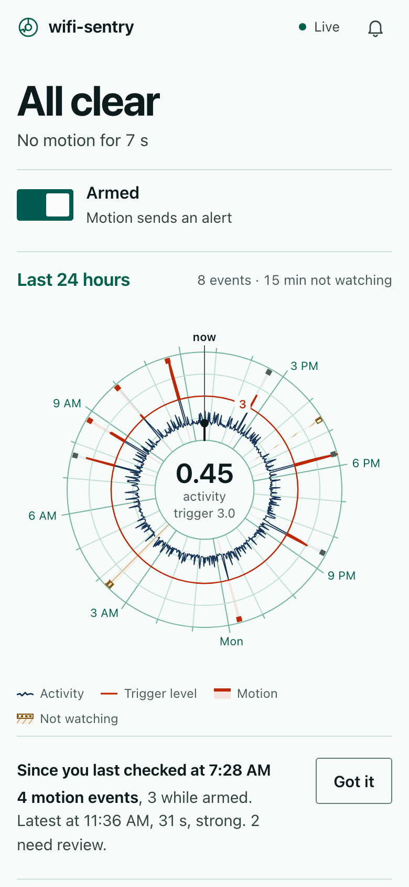
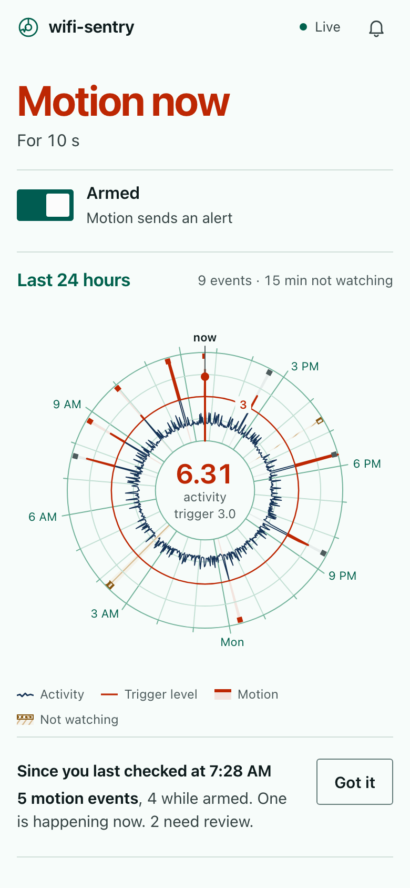
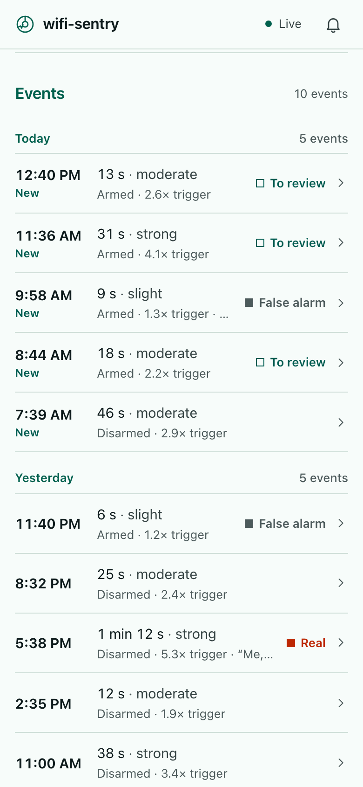
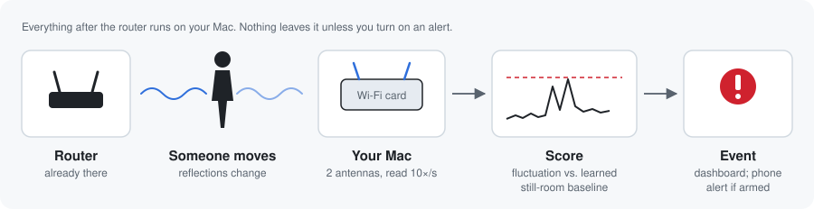
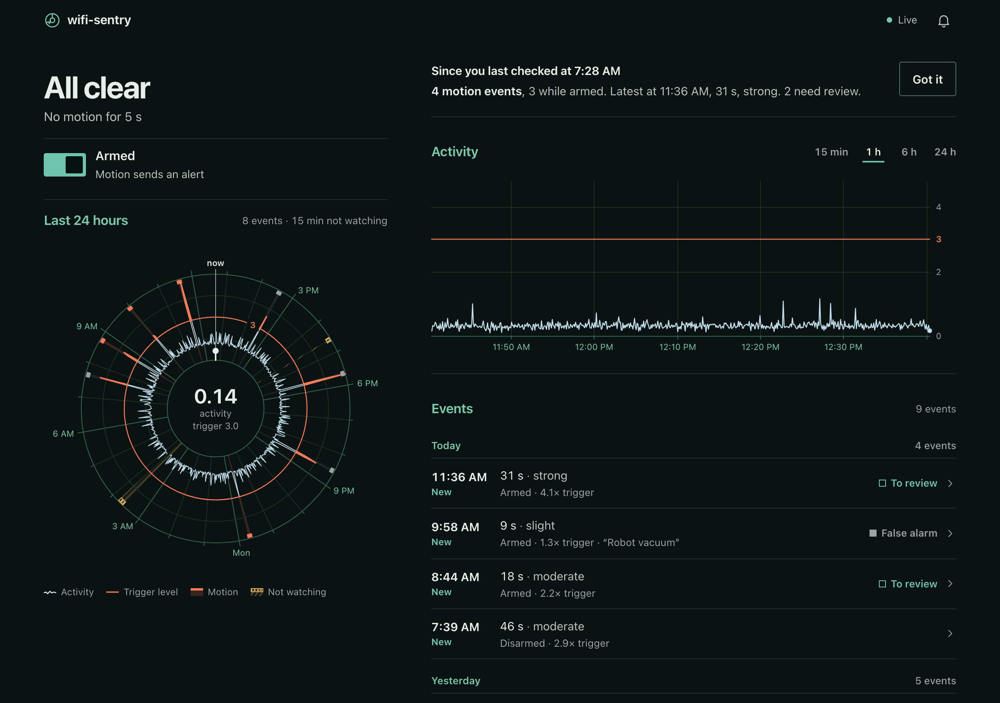
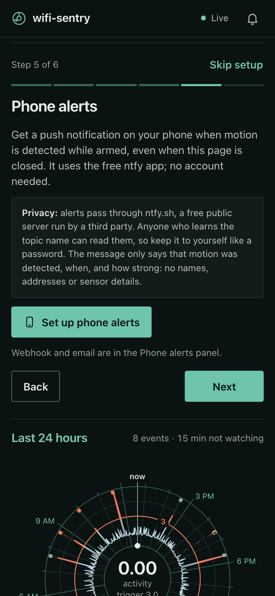

# wifi-sentry

**Turn your Mac's own Wi-Fi into a motion sensor.** No camera, no microphone, no extra hardware:
wifi-sentry watches how the signal from your router fluctuates at the Mac's antennas, learns what
your home looks like when nobody's moving, and tells you when something moves.

> **Status: early.** Detection has been tried on exactly one Mac (an Apple silicon Mac mini on
> macOS 27.0.1) in one studio apartment; a second Mac (a MacBook Pro with Apple M5 on macOS
> 27.2.1) installed from a clean copy and showed the same full two-antenna support. It relies on a
> private macOS API that may behave differently on your Mac, or break with a macOS update. If you
> try it, please [send what `./wifi-sentry probe` says](#status-help-wanted). That's the most
> useful contribution right now.

<p align="center">
  
  &nbsp;
  
  &nbsp;
  
</p>
<p align="center"><sub>The dashboard on a phone. The data is simulated: a real wifi-sentry engine replaying a recorded still room, with made-up motion and a made-up day of events. <a href="docs/img/demo.gif">Animated (all clear, motion, event logged)</a>.</sub></p>

## Quick start

```sh
git clone https://github.com/CarsonBradley/wifi-sentry.git && cd wifi-sentry
./install.sh          # checks your Mac, builds the sampler, sets up Python, runs a 2-second probe
./wifi-sentry start   # runs in the background
./wifi-sentry open    # opens the dashboard in this Mac's browser and logs it in
```

A short setup guide on the dashboard walks you through
the rest: the first **10 minutes** are spent learning what your home looks like when nothing moves
(leave the room or keep still), then a [walk test](#walk-test-and-sensitivity), phone alerts and
arming.

`./install.sh` needs the Xcode Command Line Tools and [uv](https://docs.astral.sh/uv/); it tells
you how to get either if missing and asks before installing anything (`./install.sh --yes` installs
uv without asking, for scripted setups). No sudo, no system settings changed.

## How it works



1. **Sample.** A small Swift program (`sensor/wifisense`) reads the signal strength of the
   router's frames on each of the Mac's antennas, 10 times a second. It uses a private CoreWiFi
   call: the public API only offers a heavily smoothed value that barely moves.
2. **Score.** Every second a Python engine measures how much those readings fluctuated over the
   last 3 seconds and compares that with the level it learned while the home was still.
3. **Decide.** If the score stays above the trigger level for 2 seconds, an event opens. It shows up
   on the dashboard; if you've **armed** it and set up alerts, your phone gets a notification.

It also filters a radio artifact that caused 25 of the first night's 27 false alarms. That story,
the formulas and the measurements are in **[docs/how-it-works.md](docs/how-it-works.md)**.

## What it can and can't do

**It can:**

- notice that something moved, in the room the Mac is in or between the Mac and the router;
- run on a Mac you already own, entirely locally, with a dashboard you can open on your phone;
- tell you honestly when it isn't watching (learning, Wi-Fi off, engine stopped, Mac asleep): those
  stretches are shown as "Not watching", never as "All clear", and while armed your phone gets a
  "can't sense" alert (once the Mac and its internet connection are back, if they were what failed).

**It can't:**

- say *where* someone is, *who* it is, *how many* people there are, or what they look like. It
  measures one number per antenna; there is no image of anything;
- tell a person from a pet, a robot vacuum, a fan or a swinging door;
- see breathing or small gestures;
- reliably cover a whole home. Coverage is patchy and depends on where the Mac and router are.

**What has actually been observed** (one Mac, one studio apartment, close to the router):

- Detected, confirmed by the maintainer: stirring in bed, turning off an alarm, getting out of bed,
  and coming home twice (events of 9 s and 33 s).
- Missed: while the maintainer moved around the studio for about 10 minutes, almost nothing
  registered.
- False alarms: 27 in the first ~2.5 hours of the first night, traced to a radio artifact (both
  antennas jumping +3 to +4 dB together for under 2 s). After filtering that shape, the next ~5 hours
  had no event without a confirmed cause.

Sensitivity figures you may find in the code or changelog come from a **simulated** walking model
applied to real idle recordings, not from measured walking. The ESP32 board support has
**never run on real hardware**. On other Macs only installation and sensor support have been
checked so far (one MacBook Pro); detection quality there, and on other macOS versions, is
**untested**.

## Requirements

- A Mac with Wi-Fi, joined to your network (the link to your router *is* the sensor). It should
  stay put, and so should the router.
- macOS 11 or later. Tested on macOS 27.0.1 and 27.2.1, both on Apple silicon; the Intel build
  compiles but has never run.
- Xcode Command Line Tools (`xcode-select --install`), not full Xcode.
- [uv](https://docs.astral.sh/uv/), which provides Python 3.12+ for the engine inside the project
  folder. Homebrew isn't required.
- Some traffic on the Wi-Fi link. The driver only updates the readings when frames arrive. A busy
  link was never a problem in testing; a very quiet one is untested (see
  [Troubleshooting](#troubleshooting)).

## Using it

### The dashboard

`./wifi-sentry open` opens it in the Mac's browser; `./wifi-sentry url` prints the links. Every
browser logs in once with the access token (the link carries it; afterwards a login cookie is kept
for 30 days), also on the Mac itself, so other programs and accounts on the Mac can't control it.
The dashboard shows:

- the current state (**Learning**, **All clear**, **Motion**, **Not watching**) and the live score
  against the trigger level;
- the last 24 hours as a circular chart, read like a clock: now is at the top, the day runs back
  counterclockwise, anything past the red ring crossed the trigger level, and the rim marks motion
  events and stretches when it wasn't watching (tap or hover for the time and value);
- an activity chart (15 min to 24 h) with motion events and "Not watching" stretches marked;
- a "Since you last checked" summary;
- the **Events** list: open each event and mark it **Real** or **False alarm**, with a note.
  Labelling is what makes later tuning possible.

<p align="center">
  
</p>

### Walk test and sensitivity

Settings → **Walk test**. Tap Start, walk normally for 30 to 60 seconds through the places you want
covered, including past the Mac, then tap **Stop and see results**. Nothing is alerted during the
test.

The result shows which sensitivity levels (Low, Medium, High) would have caught your walk and
recommends the **least sensitive** level that caught it reliably, which keeps false alarms lowest.
If nothing caught it, the Mac can't see those places: walk closer to the line between the Mac and
the router, or consider [ESP32 boards](#optional-esp32-boards-untested).

### Arming

The switch on the status card. **Disarmed**, events are still logged and shown, just not sent
anywhere. **Armed**, new events go to the alert channels you've set up.

- **Exit delay.** Arming from the dashboard waits 60 seconds by default (Settings → Arming: none,
  30 s, 1, 2 or 5 min) so you can leave without tripping it; motion during the delay is logged but
  never alerted. Tap the switch again to cancel.
- **Schedule.** Settings → Arming → "Arm on a schedule": day and time windows in the Mac's local
  time (e.g. 09:00–17:30 Mon–Fri; an end before the start runs overnight). Arming or disarming by
  hand wins until the next window starts or ends, and saving a schedule never flips the current
  state (it takes over at its next boundary). If you arm by hand before a trip, turn the schedule
  off, or its next boundary will take over.
- The bell icon adds sound or vibration while the page is open on screen. Phones pause background
  pages, so it's no substitute for push alerts.

### Phone alerts

All alert channels are off until you set them up, and only events that open while **armed** are
sent: one alert per event, at most one every 5 minutes (events in between are counted in the next
alert). Set them up on the dashboard, in the **Phone alerts** panel:

- **Phone (ntfy)**, the easy path: "Set up phone alerts" generates a random topic for the free
  [ntfy](https://ntfy.sh) app; subscribe to it on your phone and tap **Send test alert**. You can use
  your own ntfy server instead.
- **Webhook**: generic JSON (works with Home Assistant webhook triggers), Slack or Discord format.
- **Email** over SMTP (STARTTLS, SSL or none).

<p align="center">
  
</p>

Each channel has a test button that shows the real result or error, and failing deliveries are
flagged at the top of the dashboard. Settings are stored in `data/alerts.json` (mode 600), and
secrets are never sent back to the browser.

**When it can't watch.** While armed, the same channels also get a "can't sense" alert when the
sensor has been offline or blind (or the baseline relearning) for 2 minutes, a "watching again"
alert when it recovers, and a "was not running" alert after the engine or the Mac was down. These
have their own limit (one per 30 minutes) and never count against motion alerts. What it can't do
is tell you while the Mac itself is off or its internet connection is down. If you need that, add
an outside check (a monitoring service that expects a regular webhook, or a Home Assistant
automation that notices when the dashboard stops answering).

The public ntfy.sh server is a third party, and anyone who knows a topic can read it: the generated
topic is long and random, and alert texts contain no names or sensor details (and no dashboard link
unless you add one). Self-host ntfy if that matters to you.

You can also configure channels in `config.local.toml` (see
[docs/configuration.md](docs/configuration.md#alerts-where-armed-events-go)); a channel set up on the
dashboard replaces the file's settings for that channel.

### From your phone: Tailscale or your LAN

By default the dashboard listens on 127.0.0.1 only. To open it from other devices, add to
`config.local.toml`:

```toml
[server]
expose = ["tailscale"]   # recommended: reachable only from your own Tailscale devices
# expose = ["lan"]       # or: this Mac's Wi-Fi address; anyone on your network reaches the login page
```

Then `./wifi-sentry restart` and `./wifi-sentry url`. It prints a link containing the **access
token**. Open it once on your phone: the token is swapped for a login cookie (30 days) and removed
from the address bar. Home-screen web apps keep their own cookies, so they ask for the token once.

It is **plain HTTP**, meant for your own network or a VPN such as Tailscale. Don't forward it to
the internet. To rotate the token, delete `data/access-token` and restart; every browser is logged
out. Details: [SECURITY.md](SECURITY.md).

### Start at login

```sh
./wifi-sentry autostart on    # LaunchAgent for this folder: starts at login, restarts after a crash
./wifi-sentry autostart off
```

### All commands

```text
./wifi-sentry start | stop | restart | status
./wifi-sentry open                open the dashboard in this Mac's browser (logged in)
./wifi-sentry url                 dashboard links with the access token
./wifi-sentry doctor              full self-diagnosis
./wifi-sentry probe               what this Mac's Wi-Fi provides (~2 s)
./wifi-sentry logs [-n N] [-f]    engine log
./wifi-sentry autostart on|off    start at login
./wifi-sentry update              git pull, rebuild, restart if running
./wifi-sentry uninstall [--purge] remove the LaunchAgent, Python env and sampler (--purge: also data/)
./wifi-sentry run [ARGS]          run in the foreground
./wifi-sentry version | help
```

## Optional: ESP32 boards (untested)

Small ESP32-S3 boards (around US$8 to 16 each) can measure much richer channel state information
(CSI) in the rooms they sit in and feed the same events. The firmware is in [`esp32/`](esp32/README.md)
with a shopping list, placement advice and flashing steps.

> **The firmware compiles but has never run on a real board.** The engine side is tested only
> against a simulator (`esp32/tools/fake_esp32.py`). Expect to debug. The UDP port it uses is
> unauthenticated and off by default; see [SECURITY.md](SECURITY.md).

## Configuration

Your settings go in `config.local.toml`; it overrides `config.toml` key by key. Every key,
default and engine flag is listed in **[docs/configuration.md](docs/configuration.md)**. The HTTP
API and the live event stream are documented in [docs/api.md](docs/api.md).

Everything the engine stores lives in `data/` (git-ignored): the event database with 7 days of
score history, raw recordings for the last 24 hours (at most 2 GB; turn off with
`[record] enabled = false`), walk-test captures, logs and the access token. To wipe it:
`./wifi-sentry stop`, delete `data/`, start again (it relearns for 10 minutes).

## Troubleshooting

**Start with `./wifi-sentry doctor`.** It checks the Mac, the sampler, the config, ports,
listening addresses, the token, disk use and the LaunchAgent, and says what to do.

| Symptom | What to do |
|---|---|
| "Reduced sensing" | Your Mac reports one antenna. It still works, but radio artifacts can't be told from motion: expect more false alarms. Please [report it](docs/compatibility.md). |
| "Degraded sensing" or empty readings after a macOS update | The private per-antenna API is missing or changed. Rebuild with `sensor/build.sh`, then `./wifi-sentry restart`. If `./wifi-sentry probe` still shows no per-antenna signal, detection will be poor; ESP32 boards are the fallback. |
| "per-chain RSSI frozen (no link traffic?)" | Readings stopped changing and no packets arrive. Add `"--keepalive", "5"` to `[mac] command` in `config.local.toml` (pings the router 5×/s). |
| "Sensor offline" | `./wifi-sentry status` and `./wifi-sentry logs`. The engine restarts the sampler automatically. Run `sensor/wifisense --duration 3` to see whether it prints JSON. |
| Port already in use | `start` names the program holding it. Set `[server] port` in `config.local.toml`. |
| macOS asks whether Python may accept incoming connections | Only with the macOS firewall on and `expose` (or the ESP32 listener) set. Allow it for the phone link to work. |
| Phone link stopped working after the router gave the Mac a new address (`"lan"`) | The address is looked up at start: `./wifi-sentry restart`. A DHCP reservation on the router avoids it; Tailscale addresses don't change. |
| Phone says "Not connected" | Tailscale on the phone? Does `./wifi-sentry status` list the Tailscale address under listening? |
| Dashboard says "Enter access token" | New device, home-screen app, cookie older than 30 days, or rotated token: `./wifi-sentry open` on the Mac, or open the link from `./wifi-sentry url` on the phone. |
| Lots of false alarms | Run the walk test and use the least sensitive level that catches you. Mark events as False alarm, and keep `data/raw/` recordings if you open an issue. |
| You moved the Mac, router or furniture | Settings → **Relearn baseline**. |
| "Alerts aren't getting through" | Open **Phone alerts** and use **Send test alert** on the failing channel: it shows the server's actual answer. |

## Privacy and responsible use

- **Everything runs on your Mac.** The sampler, the detection, the database and the dashboard are
  local. wifi-sentry makes no outbound connections unless you enable an alert channel (ntfy,
  webhook or email), and then only to the server you configured. With the public ntfy.sh server,
  alert texts (time, strength, duration) pass through a third party. The dashboard loads no external
  scripts, fonts or analytics.
- **What's stored:** signal strengths, scores, events and your labels, in `data/` on your Mac.
  Note that a record of motion is also a record of when people are home; treat `data/` accordingly.
- **Use it only in your own home**, on a network you control, and make sure the people who live
  there know it's running. Sensing people in spaces you don't control, or without their knowledge,
  may be illegal where you live, and it isn't what this project is for.
- It is not a certified security or safety device. Don't rely on it to protect people or property.

## FAQ

**Does it need special hardware?**
No. It uses the Wi-Fi card already in your Mac and the router you already have. ESP32 boards are an
optional, untested add-on.

**Does it work on a MacBook?**
Partly known. A MacBook Pro (Apple M5, macOS 27.2.1) reports both antennas like the Mac mini, and
the engine learned and ran on it; how well it detects people hasn't been measured. A laptop has to
stay in one place (moving it changes the baseline) and awake: while it sleeps nothing is watched,
and the dashboard shows that time as "Not watching". If you run `./wifi-sentry probe` on another
laptop, please [report the result](docs/compatibility.md).

**Why private APIs?**
The public API gives one heavily smoothed signal-strength value that changed about once every 25
seconds on the test Mac; motion needs the per-antenna values, which only the private CoreWiFi call
provides. No entitlements, sudo or Location Services permission are needed on the tested macOS.
The sampler checks each private call's type before using it, so a changed API should show up as
"Degraded sensing" rather than a crash. That's designed in, but has only been simulated.

**Will it see my cat? My fan?**
A pet moving near the Mac can look exactly like a person; it can't tell them apart. A fan, once
running steadily, should be absorbed into the baseline after about 15 minutes. That logic is
unit-tested but hasn't been observed on real hardware.

**Can it tell where someone is?**
No. It says that something moved within what the Mac can sense, not where, who or how many.

**Does it work through walls?**
It senses disturbances to the radio path between the router and the Mac. In testing, coverage was
patchy even inside one room. Don't count on it for other rooms.

**Linux or Windows?**
No. The sampler is macOS-only. The engine is plain Python and could accept another sampler that
prints the same JSON lines ([sensor/README.md](sensor/README.md) documents the format); nobody has
written one.

More detail on the signal, the baseline and the false-alarm story: [docs/how-it-works.md](docs/how-it-works.md).

## Status: help wanted

The most useful contribution right now is a **compatibility report**: run

```sh
./wifi-sentry probe
```

and [open a compatibility report](https://github.com/CarsonBradley/wifi-sentry/issues/new?template=compatibility.yml)
with the output, your Mac model and macOS version. Known results are collected in
[docs/compatibility.md](docs/compatibility.md). Walk-test results and labelled false alarms are
the next most useful.

## Contributing

Bug reports, compatibility reports and pull requests are welcome. See
[CONTRIBUTING.md](CONTRIBUTING.md) for the development setup (the test suite runs without Wi-Fi),
the code layout and how to report a Mac. Security issues: [SECURITY.md](SECURITY.md). Changes
between versions: [CHANGELOG.md](CHANGELOG.md).

## License

[MIT](LICENSE) © 2026 Carson Bradley
