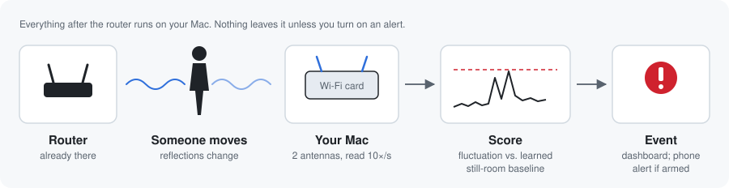

# How wifi-sentry works

This is the technical companion to the [README](../README.md): what the Mac measures, how that
becomes a motion score, how the detector learns what "nobody moving" looks like, and the story of
the radio artifact that caused nearly every false alarm on the first night.

Every number here was measured on **one Mac** (Apple silicon Mac mini, macOS 27.0.1, two receive
antennas, 5 GHz channel 157 / 80 MHz, a few metres from the router, in one studio apartment), or
comes from a simulation and is labelled as such. Nothing has been measured on another machine yet.
If you run it on yours, [a compatibility report](compatibility.md) is the most useful thing you can
send back.



## 1. The signal: per-antenna signal strength, 10 times a second

A person moving in a room changes how the router's radio waves reflect and get absorbed on their
way to the Mac. The Mac's Wi-Fi card already measures the strength of every frame it receives, per
antenna. `wifisense` (the Swift program in [`sensor/`](../sensor/README.md)) reads those values
ten times a second and prints one JSON line per reading.

- **What it reads.** `rssi_c0` and `rssi_c1`: the received signal strength on each antenna ("receive
  chain"), in whole dBm. They come from `CWFInterface.perAntennaRSSI`, a **private** CoreWiFi call
  that works without sudo, entitlements or a Location Services prompt on the tested macOS. Its data
  layout was reverse-engineered; Apple doesn't document it and may change it in any update.
- **Why per antenna.** The public signal strength (`CWInterface.rssiValue`) is smoothed by the
  driver: on the test Mac it changed 0.04 times per second, so it is nearly useless for motion. The
  per-antenna values changed about 2.9 times per second at 10 Hz sampling.
- **How noisy it is when nothing moves.** Over a 10-minute capture with the room still: per-antenna
  standard deviation about 0.5 dB, range about 5 dB, mostly a 1 dB flicker between neighbouring
  values. That capture is in the repo: `engine/tests/fixtures/mac-idle-20261123-001939.jsonl.gz`.
- **Other fields.** Noise floor, channel, MCS index, packet counters and driver statistics (channel
  busy time, retries) are read too. Some of them feed an interference discount (below); the packet
  counter tells "still room" from "no traffic".
- **It needs traffic.** The driver only updates the per-antenna values when frames arrive. On the
  test Mac other services kept the link busy (about 700 packets/s in the day, about 80 at night).
  On a completely silent link the readings may refresh less often; that wasn't tested.
  `wifisense --keepalive 5` (pinging the router five times a second) is available but was not
  needed, and an A/B test on the busy link showed no benefit.

It is coarse: two integer numbers per reading, rounded to 1 dB. That's enough to notice a body
disturbing the path near the Mac or between the Mac and the router. It isn't enough to see
breathing, gestures, where someone is, or who it is.

## 2. From readings to a score (once per second)

Every second the engine takes the last **3 seconds** of per-antenna readings (about 30 samples)
and computes one number, `r`:

```
c = (c0 + c1) / 2          common part: both antennas move together
d = (c0 - c1) / 2          differential part: the antennas move differently
r = V(d) + w * V(c)        w = mac_common_weight = 1.0
```

`V` is a **step-robust variance**: the variance left after removing the best single level step in
the window. A lone step (the router changing its transmit power, a door closing and staying shut)
scores close to zero instead of opening an event, while fluctuating motion keeps its variance. A
moving body tends to fade each antenna differently (they're more than half a wavelength apart), so
the differential part carries most of the signal; the common part also catches plain shadowing.

On the test Mac, idle `r` had a median of 0.15 dB² with a MAD (median absolute deviation) of
0.03.

`r` is then turned into a **score** against the learned idle level:

```
score = (r - median) / scale
scale = max(3 * 1.4826 * MAD, rel_floor * median, abs_floor)      abs_floor = 0.15 dB²
```

Idle scores sit around 0 to 1. A score of 3 means "three robust standard deviations above what this
room normally looks like", with a floor so a very calm baseline can't make the detector twitchy.

**Interference discount.** If the noise floor or channel busy time jumps far above its own baseline
(robust z-score above 3), the Mac's score is scaled down (never below half), because that looks
like the radio environment changing, not a body. Retry ratio is recorded but not used: rate
adaptation after a body moves also raises retries.

## 3. Events

| Sensitivity | Trigger level (score) |
|---|---|
| Low | 5 |
| Medium (default) | 3 |
| High | 2 |

- An event **opens** when the score has been at or above the trigger level for **2 seconds**
  (dips down to 60 % of the trigger don't reset the count).
- It stays open while the score stays above 60 % of the trigger, and **closes 10 seconds** after it
  drops below.
- A new burst within **30 seconds** of an event's end re-opens that event instead of creating a
  new one.
- Each event records its peak score and the trigger level in force at the time, so changing the
  sensitivity later doesn't re-rate old events.
- Every event is logged and shown on the dashboard. Only events that open **while armed** go to
  external alerts (ntfy, webhook, email): one alert per event, at most one every 5 minutes. Arming
  from the dashboard has a 60-second exit delay by default.

All of these are settings; see [configuration.md](configuration.md).

## 4. The baseline: learning what "nobody moving" looks like

- **Learning.** After a start (or "Relearn baseline") the first **10 minutes** of scores are all
  accepted as normal. The dashboard shows "Learning" with a progress bar; nothing is detected
  during that time, and it shows up on the chart as "Not watching". Keep still or leave the room.
- **Adapting.** After that, the median and MAD are recomputed every 10 seconds over the last hour
  of accepted ticks. A tick is only accepted when no event is open or building up, the last event
  ended more than 60 seconds ago, no walk test is running, and the score is below half the trigger
  level. Slow drift is tracked; anything that looks like motion is never learned.
- **Absorbing a new steady disturbance.** If a source has been rejected continuously for 15
  minutes and its feature over the last 5 minutes was elevated and stationary (a fan switched on),
  the baseline is rebuilt from that window. Intermittent human movement fails the stationarity test.
  This logic is covered by unit tests; it hasn't been observed on real hardware yet.
- **Persistence.** The baseline is saved every minute and on stop, and reused at start if it's
  less than 24 hours old, so a restart doesn't trigger relearning.
- **When you must relearn.** Moving the Mac, the router or large furniture changes the radio
  paths. Use "Relearn baseline" on the dashboard afterwards.

## 5. The first night: a radio artifact that looked like motion

The first real test was an overnight run with the maintainer asleep in the same studio, at medium
sensitivity. In the first ~2.5 hours it logged **27 events**, almost all 1 to 2 seconds long. The
raw 10 Hz recording explained them:

- **25 of the 27 were the same shape**, which the code calls a "box": **both antennas jump up
  together** by +3 or +4 dB (+4 in about 70 % of cases), the difference between the antennas stays
  within 1 dB, the level holds for about 0.6 s (never more than 1.1 s), then drops back to exactly
  where it was.
- It happened **45 times in about 3 hours**, at irregular intervals (median gap about 4 minutes).
- Nothing else visible on the Mac changed at those moments: no change in MCS, transmit rate,
  spatial streams, noise, channel load, retry or error counters, and no burst or pause in traffic.
- It **never appeared during 32 minutes of daytime captures**, when the link carried about 700
  packets/s. At night traffic fell to about 80 packets/s. The most likely explanation is the
  router's frame power or the receiver's gain control showing through when few frames arrive. That
  can't be proven from the Mac side.
- A box is two level steps close together, so the step-robust variance (which forgives *one* step)
  couldn't remove it.

**The fix** (`mac_pulse_reject`, on by default): before computing the variance, drop the samples
of any short positive box where both antennas rise by at least 2 dB together, stay within 1 dB of
each other, fall back within 2 seconds, and the 2.5 seconds before looked idle. Dips, one-antenna
changes, antennas moving differently, anything longer than 2 seconds or inside an already-moving
stretch are scored exactly as before.

Replaying the whole night's recording through the detector, before and after:

| Sensitivity | Events before | Events after |
|---|---|---|
| Low | 13 | 1 |
| Medium | 30 | 3 |
| High | 42 | 6 |

(The replay runs to 04:33, later than the point where the live engine had logged 27, so the totals
don't match exactly.) What remains at medium: two sub-second
differential wobbles that are still unexplained, and a 60 to 70 second stretch of large swings on
alternating antennas around 04:20 that looks like real movement near the Mac.

Two slices of that night's recording (03:00 to 04:05, 18 of the boxes) are in the repo as
`engine/tests/fixtures/night-*.jsonl.gz`; `engine/tests/test_night_artifacts.py` checks that the
boxes in them no longer open events while injected motion on the same quiet link still does. You
can replay them yourself:

```sh
scripts/replay.sh engine/tests/fixtures/night-20261123-0300-0326.jsonl.gz \
                  engine/tests/fixtures/night-20261123-0327-0405.jsonl.gz --learning-s 180 --quiet
```

**What the fix costs.** A body that produces only an isolated, identical, upward box on both
antennas lasting under 2 seconds is now invisible. With the injected-motion model below, the
detection rate and latency were identical before and after on the idle capture, at every intensity
and duration tried. Clean rectangular boxes were already nearly invisible before the fix (injected
±3 dB boxes of 1 to 2.5 seconds opened an event once in 54 tries, before and after alike), so a
brief, clean crossing of the Mac–router line was never something this detector caught on its own.

A second first-night issue: the dashboard showed 39 short "sensor offline" gaps. The sensor hadn't
dropped out; in a still room the whole-dB readings sat on one value for 15 to 105 seconds at a
time (113 times in 3 hours) while about 80 packets/s kept arriving, and the old rule called that
"frozen". The engine now only calls the sensor blind when the readings stop changing **and** the
packet counter stops advancing; readings unchanged for 10 minutes despite traffic are reported as
"stuck".

## 6. What has actually been detected

After the fix went in (about 04:35), the next roughly five hours had **no event without an
confirmed cause**. The events that did open, all confirmed by the maintainer:

- stirring in bed;
- turning off an alarm;
- getting out of bed (three short events);
- coming home, twice: events of **9 s** and **33 s**.

And the honest counterpart: while the maintainer moved around the studio for about 10 minutes, almost
nothing registered. Coverage is patchy, and which movements register depends on where they happen
relative to the Mac and the router. That is the reason for the walk test.

## 7. Sensitivity figures come from a model, not from walking

Detection rates quoted in code comments and in the changelog (for example "at medium, 83 % of simulated
walks of strength 1.5 dB lasting 6 s or more are caught") come from `engine/src/sentry/sim.py`: a model that adds simulated body
shadowing and multipath fading on top of the **real** idle recording. Its strength parameter `A`
(dB) is an assumption based on published RSSI device-free sensing work, not a measurement of a
person walking past this Mac. Treat these numbers as a way to compare detector versions, not as
real-world accuracy. The walk test on the dashboard measures your own room.

```sh
# inject two simulated walks into the bundled idle capture and report what each level catches
scripts/replay.sh engine/tests/fixtures/mac-idle-20261123-001939.jsonl.gz \
                  --learning-s 180 --inject 300:320,400:430 --intensity 2 --quiet
```

## 8. The walk test

Settings → Walk test on the dashboard. While it runs no events open, nothing is alerted and the
baseline is frozen. When you stop it, the engine reports the peak and median score of your walk,
whether each sensitivity level would have fired, and recommends the **least sensitive** level that
caught the walk reliably (it fired and at least 20 % of the walk's seconds were above that level's
trigger). If no level caught it, the Mac can't see the places you walked.

## 9. Other Macs: signal modes

`wifisense` prints a capabilities line at start (`{"type":"caps", ...}`) saying how many antenna
values this Mac exposes. The engine picks a scoring mode from it:

| What the Mac provides | Mode | What changes | Tested on hardware? |
|---|---|---|---|
| 2 antenna values | `dual` | the design above | yes (the one Mac) |
| 3 or 4 antenna values | `multi` | same idea generalised to N antennas | no, simulated only |
| 1 antenna value | `single` ("Reduced sensing") | can't tell a both-antennas artifact from motion; expect more false alarms | no, simulated only |
| no per-antenna value | `aggregate` ("Degraded sensing") | scores the smoothed public signal strength; detection will be poor | no, simulated only |
| Wi-Fi off / not connected / no interface | not scored | dashboard says why | no, simulated only |

The dashboard always says which mode it's in; it never silently degrades. `./wifi-sentry probe`
tells you what your Mac provides.

## 10. ESP32 boards (optional, untested on hardware)

Small ESP32 boards can measure channel state information (CSI): about 60 amplitude values per
packet instead of one number per antenna, 50 packets a second. Each board pings the router, reads
the CSI of every reply and sends it to the Mac over UDP. The engine normalises each frame, keeps the
useful sub-carriers, and scores the average time-variability of their amplitudes over 2 seconds
against the board's own learned baseline, then fuses it with the Mac's score (the highest wins).

The firmware compiles for several chips but **has never run on a real board**; the engine side is
tested only against `esp32/tools/fake_esp32.py`, a simulator. See [esp32/README.md](../esp32/README.md).

## Limits someone nearby could exploit

The detector is built to avoid false alarms, and some of those defences can be used against it:

- **Saturating the channel.** The interference discount scales the Mac's score down (to at most half)
  when noise and channel busy time jump. Someone flooding the channel on purpose lowers the score of
  real motion at the same time.
- **Slow, steady movement.** The score is the fluctuation over 3 seconds; movement slow and smooth
  enough may stay under the trigger, and a steady disturbance is absorbed into the baseline after
  15 minutes.
- **The artifact filter.** A disturbance shaped exactly like the night-time "box" (both antennas up
  together for under 2 seconds, then back) is not scored.
- **Walk tests and learning** suppress events (at most 3 minutes per walk test; 10 minutes of
  learning after a relearn). Both need the access token, and while armed, learning longer than 2
  minutes sends a "can't sense" alert.

[SECURITY.md](../SECURITY.md) has the rest of the threat model.

## Where the code is

| Step | File |
|---|---|
| Reading the Wi-Fi card | `sensor/Sources/main.swift` |
| Feature `r`, step-robust variance, box mask, signal modes | `engine/src/sentry/features.py` |
| Baseline (median/MAD, gating, absorption) | `engine/src/sentry/baseline.py` |
| Fused score, events, walk test | `engine/src/sentry/detector.py` |
| Injected-motion model | `engine/src/sentry/sim.py` |
| Replay tool | `engine/src/sentry/replay.py`, `scripts/replay.sh` |
